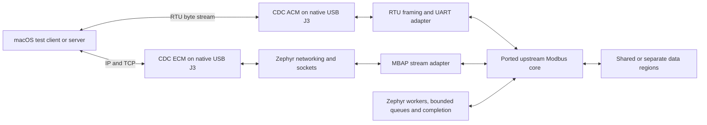

# Modbus migration to NK-M3351KI / Zephyr

## Outcome and accepted decisions

Port **alejoseb/Modbus-STM32-HAL-FreeRTOS itself**, retaining its protocol and data-model logic rather than replacing it with Zephyr's Modbus subsystem.

The user selected:

* Both **master/client and slave/server**, for **RTU and TCP**.

* The M3351's **native USB device connection**, not the Nu-Link UART bridge, for RTU.

* A composite **CDC ACM serial + CDC ECM network** device, allowing real RTU and TCP verification over the same target USB cable on macOS.

* Zephyr-native replacements for STM32/FreeRTOS/lwIP C types and completion mechanisms; preserve useful API names and Modbus behavior, not binary/source compatibility with HAL-dependent structs. Correct malformed-frame behavior rather than preserving upstream bugs.

Deliver a reusable library, server/client demonstration configurations, automated protocol tests, PC interoperability tests, and reproducible build/validation documentation. All implementation and checks below are future work; no build, installation, flash, or hardware test has been performed.

## Established evidence

* The workspace contains no application source, build system, or project instructions; all application paths below are **proposed new files**.

* Zephyr has the target `numaker_m3351ki/m335xxx` in its current development tree. The board file was absent at the checked `v4.3.0` tag. Select and pin a specific commit containing board, SoC, HAL-module, and USB-driver support; do not depend on a floating `main` branch or assume a released SDK supports this board. \[Z1]

* Board/SoC sources describe 128 KiB SRAM, 1 MiB flash, UART0 as console, an enabled `zephyr_udc0`, 1,024 bytes of USB controller buffer RAM and an endpoint-pool property of 23. This makes ACM+ECM a credible integration, **not a demonstrated working composite device**. Keep upstream clock/pin setup and validate actual endpoint allocation. \[Z2]

* The board manual identifies **J3** as target USB FS and **ICEJ2** as Nu-Link programming/debug USB. Initial flashing requires a working debug/programming path; native application USB is not assumed to be a bootloader. Follow the actual board revision's power configuration. \[H1, p.19, table 3-9]

* Zephyr's `board.cmake` selects pyOCD target `m3351kjcae`, whereas board documentation identifies M3351KICAE. The OpenOCD configuration uses `interface/nulink.cfg` and `target/numicro.cfg`. Verify the installed runner's exact device/flash support before writing flash; do not assume these names establish compatibility. \[Z3]

* Upstream supports FC01/02/03/04/05/06/15/16, shared register memory and optional separate regions, queued master requests, multiple handlers, and a bounded TCP connection pool. Its public header exposes HAL, FreeRTOS/CMSIS, and lwIP types. \[M1–M3]

* Upstream TCP reception assumes one whole request per netbuf and uses an incorrect OR test for the two protocol-ID bytes; the Bluepill CDC callback replaces the frame buffer on each receive callback. These paths must be adapted to streams, not copied literally. \[M2, lines 698–729; M4, lines 261–294]

* **Updated user confirmation:** the board is physically connected and is expected to enumerate as a **CMSIS-DAP debugger**. Treat CMSIS-DAP over SWD as the intended programming/debug interface, distinct from native J3 application USB. The available serial/trace inventory query returned no ports/probes, but it did not establish a current CMSIS-DAP USB identity. A CMSIS-DAP device need not expose a serial port; do not infer that the board is disconnected. Confirm USB VID/PID, serial number and CMSIS-DAP interface before selecting the probe.

### Installed dependency inspection

Read-only file inspection found:

| Component | Evidence / status |
|---|---|
| OpenOCD | ARM64 Homebrew `open-ocd/0.12.0_1`; executable present at `/opt/homebrew/Cellar/open-ocd/0.12.0_1/bin/openocd`. Runtime execution/linkage has not been checked. |
| CMSIS-DAP adapter support | Installed `share/openocd/scripts/interface/cmsis-dap.cfg` selects `adapter driver cmsis-dap`. This establishes available configuration, not a successful probe connection. |
| USB host dependencies | Homebrew libusb 1.0.30 and hidapi 0.15.0 are present and listed in OpenOCD's installation receipt. |
| M3351 flash support | **Unverified.** Installed `target/numicro.cfg` identifies itself as Cortex-M0 and carries old-family defaults. Do not use it unchanged on this Cortex-M33 or treat the presence of OpenOCD as proof of a suitable flash algorithm. |
| Embedder Python environment | `/Users/embedder/.embedder/python-venv` is Python 3.9.6 with only pip/setuptools-related packages; pyOCD, west and PC test packages are absent from this environment. Do not modify this runtime-owned environment. |
| ARM toolchain cache | Both inspected xPack `*.extracting-*` directories under `.embedder/tools/gdb/` are empty, not installed toolchains. |
| Zephyr build/test tools | No Zephyr checkout, SDK, west installation or complete ARM compiler was found in inspected locations. CMake, Ninja, dtc, gperf and QEMU were not present in the inspected Homebrew Cellar. This is a scoped inspection, not proof that no alternative installation exists elsewhere. |

**Dependency readiness is not yet established.** No host-command execution or live CMSIS-DAP enumeration was available through the current read-only tool set. The current Zephyr getting-started guide specifies Python >=3.12, CMake >=3.28.0 and dtc >=1.4.6; recheck against the exact pinned revision. [Z7] The inspected Python 3.9.6 environment is not adequate for that baseline.

## Recommended architecture



Use Zephyr's existing Nuvoton UDC, CDC classes, UART API, kernel, and networking stack. Do not implement USB controller/class drivers, fake a network link with serial tunneling, or retain a second lwIP/FreeRTOS runtime.

### Library boundary and scheduling

* Extract portable CRC, request/response encoding, FC dispatch, and memory-region lookup from upstream `Modbus.c` with minimal unrelated refactoring.

* Retain names such as `modbusHandler_t`, `modbus_t`, `ModbusInit`, `ModbusStart`, `ModbusStartCDC`, `ModbusQuery`, `ModbusQueryV2`, and `ModbusQueryInject` where meaningful. Document changed types, initialization errors, and asynchronous completion. Do not implement undocumented global timeout functions merely because the upstream header declares them.

* Replace UART/GPIO handles with Zephyr device/GPIO configuration; replace lwIP objects with socket/endpoint state. Provide caller-owned per-request completion/result storage instead of FreeRTOS task notification addresses.

* Preserve FIFO query ordering and front-injection semantics using bounded, preallocated request nodes and a queue supporting append/prepend. Copy telegram metadata; document that caller data/result buffers remain valid until completion or acknowledged cancellation.

* Use one worker per active handler, explicit event kinds for RX readiness, TX progress, and timeout, and generation/state checks to reject stale timeout events. Timer/driver callbacks signal work only: no blocking socket calls, parsing, or application mutex acquisition there.

* Serialize transactions on each RTU interface. Share a data-bank lock when multiple handlers reference the same memory, and hold it only while accessing the bank, never while waiting for USB/network I/O. Report queue/buffer exhaustion without silent overwrite or infinite loops.

### RTU transport

* Use the CDC driver's interrupt-driven UART API with bounded RX/TX buffers and partial-write handling. Keep USB buffers alive until accepted; clear stale transport state on disconnect and fail outstanding requests deterministically.

* Accumulate a byte stream across USB callbacks. For supported FCs, derive candidate ADU lengths from the function and byte-count fields, validate CRC, and retain remaining bytes; use bounded partial-frame expiry and gap-based recovery for unsupported/invalid frames. Never equate a USB packet or host read with a Modbus message.

* USB CDC line coding is metadata, not real UART timing. Use configurable CDC assembly/response deadlines and test fragmented transfers under USB scheduling delays. Keep physical UART T1.5/T3.5 framing separate and based on the serial configuration/specification, not FreeRTOS tick constants. \[P1]

* Preserve RTU CRC byte order, addressing, exceptions, and write-broadcast/no-response behavior. Reject CRC failures without replying; validate lengths, quantities, FC05 values, FC15/16 byte counts, address arithmetic, and destination capacity before access.

* Provide the reusable interrupt-driven physical-UART adapter through the same library boundary. Native USB is the hardware acceptance path; physical RS-485 electrical/direction timing and STM32 DMA-specific operation are not certified by USB tests. Reject unsupported DMA selection explicitly rather than silently substituting behavior.

### TCP transport

* Replace lwIP netconn calls with Zephyr socket APIs. Retain client endpoint/port selection, server port configuration (default 502), bounded multi-client capacity, and configurable idle connection expiry.

* Maintain an independent MBAP accumulator and TX offset per connection. Parse header/length first, reject nonzero protocol IDs and invalid lengths, handle fragmented/coalesced ADUs, partial sends, orderly close, and socket errors. TCP frames contain no RTU CRC.

* Correlate master replies with transaction ID, unit, function, quantity and expected response shape before copying. Reusing a client slot for a different endpoint must close/reconnect or return a clear error.

* Keep the reference four-connection capacity configurable. Replace poll-count aging with a documented elapsed idle timeout derived from the selected reference configuration, so scheduling/traffic cannot distort expiry. Do not silently choose a new timeout value.

* Keep one outstanding transaction per client slot unless already supported by the reference; preserve concurrency across independent handlers/connections.

### Native USB and networking

* Adapt the pinned Zephyr CDC ACM example and CDC ECM configuration from `samples/net/zperf`, using `CONFIG_USB_DEVICE_STACK_NEXT`. Use public `usbd_*` APIs with one lifecycle owner; sample-only `sample_usbd_*` helpers are not application APIs. \[Z4–Z6]

* Define one full-speed USB configuration with ACM and ECM, correct interface association/descriptors, and explicit error checking for class/endpoint registration. Disable competing CDC boot initialization if application initialization owns USB.

* Keep diagnostics on UART0/Nu-Link VCOM, never on the binary Modbus ACM channel. Boot without a terminal; CDC DTR/open readiness must not block TCP startup. Recover both functions after USB removal/reset/reconnect.

* Give ECM a stable locally administered unicast MAC identity. Document an isolated configurable private IPv4 subnet for board/PC, select it after checking for host route conflicts, and do not add a gateway or change the Mac's default route. Bind test services to this interface.

* Make USB VID/PID/product identity explicit configuration. Standalone vendor/Zephyr reference-sample tests may retain their sample identities; the migrated composite application must use a team-approved development identity. Do not claim ownership of Nuvoton or Zephyr VID/PID values or ship sample IDs as production identifiers.

## Proposed files and implementation order

| Order | Proposed files/components                                                                                                                                                           | Result                                                                                                                                                                                                 |
| ----- | ----------------------------------------------------------------------------------------------------------------------------------------------------------------------------------- | ------------------------------------------------------------------------------------------------------------------------------------------------------------------------------------------------------ |
| 1     | `west.yml`, `CMakeLists.txt`, `Kconfig`, `prj.conf`, `.gitignore`, `README.md`                                                                                                      | Standalone Zephyr application; immutable dependency revisions and documented macOS toolchain/bootstrap requirements. Keep generated dependencies/build output out of source control.                   |
| 2     | `lib/modbus/Inc/Modbus.h`, `lib/modbus/Config/ModbusConfig.h`, `lib/modbus/Src/Modbus.c`, `ModbusCore.c`, `ModbusRtu.c`, `ModbusTcp.c`, library CMake/Kconfig, `lib/modbus/LICENSE` | Import the selected upstream library with provenance/license notices; separate portable logic, Zephyr lifecycle, and transports. Preserve traceability instead of copying every STM32 example/project. |
| 3     | `tests/protocol/`, `tests/zephyr/` and test build metadata                                                                                                                          | Golden-vector and negative tests for the extracted core and framing; Zephyr scheduling/queue/completion tests. Add these alongside each ported layer.                                                  |
| 4     | `boards/numaker_m3351ki.overlay`, `src/usb.c`, `src/network.c`                                                                                                                      | Composite ACM+ECM setup, deterministic interface lifecycle and network addressing, separate logging. Reuse upstream board drivers without local board duplication.                                     |
| 5     | `src/main.c`, `src/demo_data.c`, `config/server.conf`, `config/client.conf`, `config/separate-regions.conf`                                                                         | Server image exposes RTU and TCP concurrently; client image exercises both against PC servers. Build-time role selection avoids a new serial command protocol.                                         |
| 6     | `tools/modbus_verify.py`, pinned Python test requirements, `docs/migration.md`, `docs/validation.md`                                                                                | Repeatable PyModbus interoperability plus raw malformed-frame tests, migration/API guide, exact connection/build instructions, and evidence report.                                                    |

Once the workspace/toolchain is initialized, the planned application build entry points are:

```sh
west build -b numaker_m3351ki/m335xxx -d build/server . -- -DEXTRA_CONF_FILE=config/server.conf
west build -b numaker_m3351ki/m335xxx -d build/client . -- -DEXTRA_CONF_FILE=config/client.conf
```

Use separate build directories for diagnostic samples and alternate memory-map configurations; do not flash these commands through an unarbitrated shell workflow.

Use the Bluepill USB example's unit ID 10 and 16-word zero-based shared bank for RTU, and the F429 TCP example's configurable unit ID 1 / port 502 and 16-word bank for TCP server demonstrations. Retain independent banks unless explicitly configured to share. Test the README's separate-region mapping as a second configuration: coils 0, discrete inputs 100, holding registers 200, input registers 300, with its documented sizes. Use actual protocol offsets, not human-readable 4xxxx notation. Client tests target these maps; the PC TCP server port is configurable so tests need not run as root.

Retain the reference 128-byte configured buffer limit by default, but use non-truncating length/index types and validate any larger configured capacity against protocol maxima. Test an enlarged-buffer configuration as well; do not advertise unrestricted protocol maximum quantities in the default small-buffer profile.

## Reference deviations and rationale

| Deviation                                                                              | Reason / compatibility impact                                                                                                                                                                                   |
| -------------------------------------------------------------------------------------- | --------------------------------------------------------------------------------------------------------------------------------------------------------------------------------------------------------------- |
| STM32/Cube projects → Zephyr CMake/west on M3351                                       | Requested platform/OS migration; no STM32 startup, clocks, IRQ handlers, or `.ioc` files carried over.                                                                                                          |
| FreeRTOS/CMSIS → native Zephyr objects and explicit completion                         | User-approved C API changes; preserve queue ordering, data ownership and handler isolation, not RTOS object layout.                                                                                             |
| STM32 HAL USB → Zephyr Nuvoton UDC + CDC ACM                                           | Native target USB requested; no packet-boundary assumptions or custom USB driver.                                                                                                                               |
| Physical Ethernet/lwIP examples → Zephyr sockets over USB ECM                          | User-approved additional USB network interface permits actual TCP tests with no external adapter. New USB descriptors, MAC/IP configuration are documented.                                                     |
| USB per-callback frames → stream assembly; TCP per-netbuf frames → MBAP stream parsing | Correct operation across normal fragmentation/coalescing; valid Modbus wire messages remain unchanged.                                                                                                          |
| Invalid-frame handling and buffer/type checks corrected                                | User approved correcting upstream bugs; preserve successful FC/register behavior, document intentional error-path changes.                                                                                      |
| Tick/poll-dependent timing → explicit time units and elapsed deadlines                 | Zephyr timing is not a FreeRTOS tick count; derive/document reference-equivalent settings and test boundary behavior. Physical UART timing follows the serial specification; CDC is not an RS-485 timing claim. |
| Repeated STM32 demos → server/client configurations on one board                       | Both protocol roles remain available; no master and slave competing for the same ACM channel. No display, LED mapping, extra serial control interface, or persistence added.                                    |
| STM32 UART DMA option not carried over as a HAL emulation                              | No evidence of a matching M3351 Zephyr asynchronous-UART path; reusable IRQ UART/CDC transport is provided, with DMA and RS-485 hardware limits explicitly stated.                                              |
| Wider internal length types; same default buffer/map limits                            | Prevent 8-bit wraparound and enable safely bounded larger configurations without silently changing the default application map.                                                                                 |

Retain LGPL-2.1 notices/provenance for the upstream-derived library and applicable Zephyr sample notices. Document modified files and redistribution/relinking obligations; do not relabel the port as wholly Apache-licensed.

## Verification gates

### 1. Reproducibility and target build

**Complete dependency/probe readiness before migration work:**

1. Refresh the dedicated hardware inventory and identify the user-confirmed CMSIS-DAP device by VID/PID, serial number and v1 HID/v2 bulk interface. Do not require a COM port and do not start a debug server merely to enumerate it. No reset/attach/flash during discovery.
2. Check executable paths and versions for Git, supported Python, CMake, Ninja, dtc, gperf, west, the ARM compiler/GDB and the selected simulator. Inspect existing installations first; reuse valid ones rather than reinstalling blindly. Verify executable loading as well as package-directory presence.
3. Create a project-owned Python environment using the pinned Zephyr revision's supported Python version; install west, that checkout's Python requirements and pinned PC test dependencies there. Do not upgrade Embedder's Python environment. Acquire the compatible macOS ARM64 Zephyr SDK/toolchain and only missing host packages after approval; record versions and dependency checks.
4. Prefer **pyOCD with verified M3351KICAE device support** for the CMSIS-DAP probe. Establish whether a supported built-in target or vendor CMSIS Device Family Pack supplies the exact device/memory map/flash algorithm before installing it. Validate the result against the physical part. Resolve the upstream `m3351kjcae` runner-name discrepancy explicitly; do not substitute a generic Cortex-M target for flashing. [D1]
5. Do not use the upstream board's `interface/nulink.cfg` when the probe enumerates as CMSIS-DAP. If pyOCD cannot support the exact device, stop and evaluate a verified Nuvoton-supported CMSIS-DAP OpenOCD build/configuration; the installed stock M0 `numicro.cfg` is not an approved fallback.
6. Record immutable dependency commits, versions and the selected probe identity. Accept readiness only when required tools execute, Python dependencies validate, the exact MCU support is available, and the minimal target build links. Live target identification/attach is a separate, authorized hardware check; it is not implied by successful USB enumeration.

Then verify the selected revision's board and all four protocol/role configurations compile. Inspect merged `.config`, `zephyr.dts`, ELF/map and boot/link address: USB classes and TCP must actually be enabled, logs must use UART0, and memory must fit 128 KiB SRAM with measured stack/pool headroom.

Build the pinned upstream CDC example and ECM networking reference separately before composite integration. Establish driver/board operation before diagnosing the port. Do not change boot partitions, option bytes, security state, or install MCUboot merely because the board DTS lists partitions.

### 2. Host tests and emulated Zephyr tests

Run portable-core tests with macOS host clang and memory/undefined-behavior sanitizers where supported. Test Zephyr lifecycle/concurrency with ztest on an available supported emulation target; do not assume Linux-only `native_sim` works directly on macOS.

Cover:

* Every supported FC in both roles; shared-bank aliasing and isolated regions; first/last/out-of-range addresses; bit ordering and CRC golden vectors.

* Zero/excessive quantities, truncated/extra bytes, malformed FC15/16 counts, invalid FC05 values, overflow arithmetic, unsupported FCs, wrong unit, corrupt CRC and broadcast behavior; failed requests cannot modify memory.

* Master response matching, exception completion, queue-full/front-injection ordering, timeout races, cancellation and disconnect; no result-buffer access after ownership is released.

* RTU chunks split at every byte boundary and across 64-byte USB packets, multiple buffered frames, incomplete-frame recovery and backpressure.

* TCP split/coalesced ADUs, invalid MBAP fields, partial I/O, connection-limit behavior, slot reuse, concurrent clients, expiry and reconnection.

These tests verify software behavior, not physical USB timing or enumeration.

### 3. Physical board / macOS acceptance

Prerequisites: user-confirmed connected NK-M3351KI with verified board revision, enumerated CMSIS-DAP/SWD programming access and exact MCU support, data-capable J3 USB cable for application tests, approved flash operation, and permission for isolated host-interface configuration. Use dedicated server-arbitrated hardware tools for flashing, reset, and live protocol access; do not bypass ownership with shell serial/flashing scripts. Ensure binary RTU writes use a raw-byte transport, not a text helper that appends LF.

1. Verify exact target/flash algorithm and back up any preservable existing firmware/configuration before authorized replacement. Stop for approval before mass erase, protection changes, or probe-firmware changes.
2. Verify standalone CDC, then ECM, then composite enumeration. Record VID/PID, serial/interface identities, discovered `/dev/cu.*` path and Mac USB network interface; rediscover after reset.
3. Configure private IPs without a default gateway. Demonstrate network reachability and bidirectional TCP traffic, not just a visible network interface.
4. Server image: PC reads/writes and verifies FC01/02/03/04/05/06/15/16 over RTU and TCP, including raw exception/CRC/broadcast tests and simultaneous traffic. Demonstrate four TCP clients and defined handling of an additional client.
5. Client image: PC serial/TCP servers verify the board's requests and return known data/exceptions; prove successful results, timeouts and reconnect behavior. Exercise all FCs in both transports.
6. Exercise payloads larger than one USB packet, configured maximum-size boundaries, at least 1,000 deterministic transactions per transport/role, host port close/reopen, unplug/replug, no-terminal boot and repeated cold boots. Require zero unexplained mismatches, corrupted replies, crashes or deadlocks; report deliberate timeout/error cases separately and record transaction latency and memory/pool high-water marks.
7. Save firmware hashes, dependency revisions, configuration, test parameters and machine-readable results. Report builds, host tests, emulation and board tests separately. A build or successful flash alone is not migration acceptance.

## Remaining implementation prerequisites / stop conditions

* Resolve and pin the exact Zephyr/library revisions and compatible macOS toolchain during acquisition; current moving-branch evidence is not a reproducible dependency lock.

* Confirm the flash runner really supports this exact MCU/probe combination. The board runner's target-name discrepancy must not be ignored.

* Obtain/confirm the development USB identity before flashing the migrated composite image; production USB identifier allocation is outside this migration.

* Composite ACM+ECM operation and macOS binding are unverified. If upstream drivers cannot support the combination, report the failing layer and evidence before proposing custom drivers or changing the user-approved USB interface.

* Hardware and host network configuration require access/approval. Complete software-only evidence when hardware is unavailable, but leave physical acceptance explicitly pending.

## Source references

* **Z7:** [Zephyr getting started / current dependency minimums](https://docs.zephyrproject.org/latest/develop/getting_started/index.html).
* **D1:** [pyOCD CMSIS Device Family Pack support](https://pyocd.io/docs/target_support.html).
* **Local dependency evidence:** `/opt/homebrew/Cellar/open-ocd/0.12.0_1/INSTALL_RECEIPT.json`; that installation's `share/openocd/scripts/interface/cmsis-dap.cfg` and `share/openocd/scripts/target/numicro.cfg`; `/Users/embedder/.embedder/python-venv/pyvenv.cfg` and its inspected package directory. These establish file/package presence only, not successful execution or target access.

* **M1:** [Upstream README and memory models](https://github.com/alejoseb/Modbus-STM32-HAL-FreeRTOS/blob/master/README.md).

* **M2:** [MODBUS-LIB/Src/Modbus.c](https://github.com/alejoseb/Modbus-STM32-HAL-FreeRTOS/blob/master/MODBUS-LIB/Src/Modbus.c): FC list 293–303, worker creation 313–411, TCP pool/receive 640–729, query APIs 950–1003, request validation 1570–1715 in the inspected snapshot.

* **M3:** [MODBUS-LIB/Inc/Modbus.h](https://github.com/alejoseb/Modbus-STM32-HAL-FreeRTOS/blob/master/MODBUS-LIB/Inc/Modbus.h), especially telegram/handler/API definitions 153–295; [configuration template](https://github.com/alejoseb/Modbus-STM32-HAL-FreeRTOS/blob/master/MODBUS-LIB/Config/ModbusConfigTemplate.h).

* **M4:** [Bluepill USB reference](https://github.com/alejoseb/Modbus-STM32-HAL-FreeRTOS/tree/master/Examples/ModbusBluepillUSB), `CDC_Receive_FS` and USB handler setup; [F429 TCP reference](https://github.com/alejoseb/Modbus-STM32-HAL-FreeRTOS/tree/master/Examples/ModbusF429TCP).

* **Z1:** [Zephyr board documentation](https://docs.zephyrproject.org/latest/boards/nuvoton/numaker_m3351ki/doc/index.html).

* **Z2:** [Board DTS](https://github.com/zephyrproject-rtos/zephyr/blob/main/boards/nuvoton/numaker_m3351ki/numaker_m3351ki.dts); [M335x DTS](https://github.com/zephyrproject-rtos/zephyr/blob/main/dts/arm/nuvoton/m335x.dtsi), USB node 339–351; [Nuvoton UDC driver](https://github.com/zephyrproject-rtos/zephyr/blob/main/drivers/usb/udc/udc_numaker.c).

* **Z3:** [Board runner selection](https://github.com/zephyrproject-rtos/zephyr/blob/main/boards/nuvoton/numaker_m3351ki/board.cmake); [OpenOCD configuration](https://github.com/zephyrproject-rtos/zephyr/blob/main/boards/nuvoton/numaker_m3351ki/support/openocd.cfg).

* **Z4:** [CDC ACM sample](https://github.com/zephyrproject-rtos/zephyr/tree/main/samples/subsys/usb/cdc_acm).

* **Z5:** [CDC ECM overlay](https://github.com/zephyrproject-rtos/zephyr/blob/main/samples/net/zperf/usbd_cdc_ecm.overlay); [USB configuration](https://github.com/zephyrproject-rtos/zephyr/blob/main/samples/net/zperf/overlay-usbd.conf).

* **Z6:** [USB initialization reference](https://github.com/zephyrproject-rtos/zephyr/blob/main/samples/subsys/usb/common/sample_usbd_init.c); [public USB API/lifecycle](https://docs.zephyrproject.org/latest/services/connectivity/usb/device_next/usb_device.html).

* **H1:** [NuMaker-M3351KI User Manual Rev1.00](https://www.nuvoton.com/export/resource-files/en-us--UM_NuMaker-M3351KI_Rev1.00.pdf), connector table 3-9, p.19, visually checked with magnified PDF tiles.

* **P1:** [Modbus application and serial-line specifications](https://www.modbus.org/modbus-specifications).

